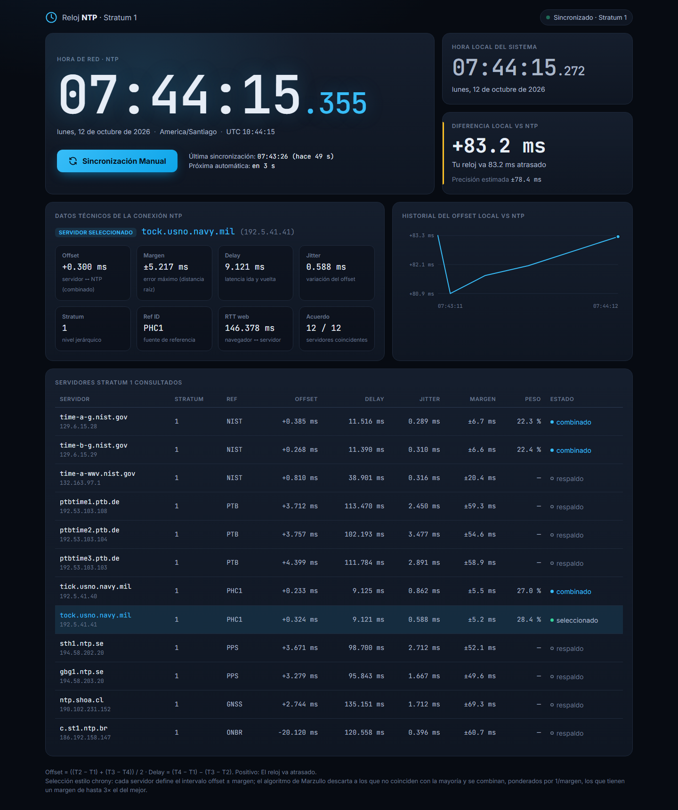

# stratum1-clock

Aplicación web que muestra la hora exacta sincronizada con varios servidores NTP Stratum 1 (NIST, PTB, USNO, Netnod, SHOA, NTP.br) y la compara con el reloj local.

## Demo en vivo

🔗 **<https://stratum1-clock.onrender.com/>**





## Uso

```bash
git clone https://github.com/sebcld/stratum1-clock.git
cd stratum1-clock
npm start          # o: node server.js
```

Abrir <http://localhost:3000>. No requiere dependencias (solo Node.js ≥ 20.12).

> El servidor necesita poder enviar tráfico **UDP al puerto 123**. Si el firewall lo bloquea, la interfaz mostrará "Ningún servidor NTP respondió".

## Configuración

La configuración opcional va en un archivo `.env` en la raíz del proyecto (está en `.gitignore`, nunca se sube al repositorio). Usa `.env.example` como plantilla:

```bash
cp .env.example .env
```

| Variable            | Descripción                                                      |
|---------------------|------------------------------------------------------------------|
| `PORT`              | Puerto HTTP (por defecto `3000`)                                 |
| `CLOCK_ADMIN_PARAM` | Nombre del parámetro oculto de la URL para el acceso del dueño  |
| `CLOCK_ADMIN_KEY`   | Valor secreto de ese parámetro                                   |

Si `CLOCK_ADMIN_PARAM` o `CLOCK_ADMIN_KEY` quedan vacíos, la sincronización del reloj del equipo queda desactivada para todos.


## Cómo funciona

La sincronización se hace en dos tramos, ambos con el algoritmo de NTP:

1. **Servidor ↔ NTP (UDP 123)** — `ntp.js` implementa un cliente SNTP. Para cada servidor:
   - `offset = ((T2 − T1) + (T3 − T4)) / 2`
   - `delay = (T4 − T1) − (T3 − T2)`
   - `jitter` = RMS de las diferencias entre offsets sucesivos (últimas 8 muestras).
   - `margen` (distancia raíz, RFC 5905) = `(delay + root delay) / 2 + root dispersion + precisión + jitter`: el error máximo de ese offset.

   Resincroniza cada 64 s y combina los servidores Stratum 1 al estilo de **chrony** (`selection.js`):
   1. Cada servidor define el intervalo `offset ± margen`.
   2. **Algoritmo de Marzullo:** se busca el intervalo en el que coincide la mayoría; los servidores que no lo tocan se marcan como *descartados* (falsetickers). Si no hay mayoría, se mantiene el offset anterior.
   3. El de menor margen queda **seleccionado**; los que tienen un margen de hasta 3× el suyo (`combinelimit 3`, como en chrony) se **combinan** con un promedio ponderado por `1/margen`. El resto queda como **respaldo**.

   Así, desde Chile, `ntp.shoa.cl` (≈ 6 ms de delay) domina el resultado, y los servidores lejanos sirven de respaldo y de control de calidad.
2. **Navegador ↔ servidor (HTTP)** — el navegador repite el cálculo contra `/api/time` (8 muestras, se usa la de menor RTT) y anima el reloj con `performance.now()`.

La precisión final estimada es `±(RTT web / 2 + margen del servidor seleccionado)`.

Para respetar las normas de uso de NIST (no más de una consulta cada 4 s), cada ronda envía un solo paquete por servidor y la sincronización manual tiene un intervalo mínimo de 8 s; si se pulsa antes, solo se re-mide el tramo navegador ↔ servidor.

## Sincronizar el reloj del equipo (acceso oculto)

Esta función está oculta al público. Solo aparece al abrir la página con el parámetro secreto definido en `.env`:

```
http://localhost:3000/?<CLOCK_ADMIN_PARAM>=<CLOCK_ADMIN_KEY>
```

El servidor valida el parámetro (comparación en tiempo constante); sin él, el botón no se muestra y los endpoints `/api/system*` responden `404`. Ni el nombre ni el valor del parámetro aparecen en el código del frontend.

Con acceso, el botón **Sincronizar este equipo** detecta el sistema del dispositivo (Windows 10/11, macOS, Linux, Android, iOS/iPadOS, ChromeOS):

- **Mismo equipo que el servidor y con permisos de administrador** → ajusta el reloj tras confirmar:
  - Windows: `Set-Date -Adjust` (ajuste relativo; la latencia de PowerShell no afecta)
  - Linux: `date -s @<epoch>`
  - macOS: `sntp -sS <servidor actual>`
- **Sin permisos** → indica cómo reiniciar el servidor como administrador (`npm start` en una terminal "Ejecutar como administrador", o `sudo npm start`) y muestra los comandos manuales.
- **Otro dispositivo** (móvil, otro PC en la red) → una página web no puede cambiar su hora; muestra los pasos para ese sistema.

Además del parámetro oculto, el ajuste solo se acepta desde `localhost` con el `Host` exacto y la cabecera `X-Clock-Sync: 1`, así que ni otros equipos de la red ni otras páginas web pueden dispararlo aunque conozcan la URL.

## API

| Método | Ruta               | Descripción                                                    |
|--------|--------------------|----------------------------------------------------------------|
| GET    | `/api/time`        | `{ synced, t2, t3 }` en hora NTP (ms Unix)                     |
| GET    | `/api/status`      | Estado completo y tabla de servidores                          |
| POST   | `/api/sync`        | Fuerza una sincronización                                      |
| GET    | `/api/events`      | Server-Sent Events con el estado tras cada sync                |
| GET    | `/api/system`      | SO del servidor y permisos (requiere el parámetro oculto)      |
| POST   | `/api/system/sync` | Ajusta el reloj del sistema (parámetro oculto + localhost + admin) |
